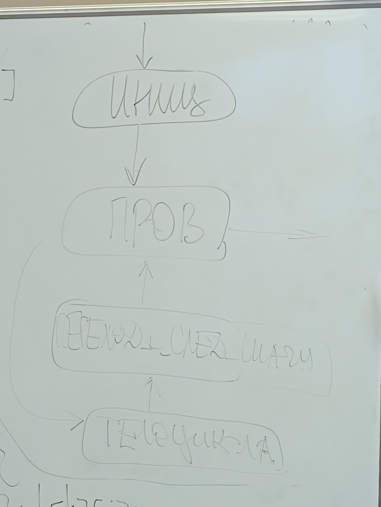

`liliya@bmstu.ru`

**Инструменты анализа ресурсной эффективности алгоритмов (временная и емкостная)**

# Анализ алгоритмов

## Умножение матриц

Первый алгоритм умножения матриц

1. Первый самый наивный
   C[i][j] = Sum(A[i][k]\*B[k][j])
   A:mxn B:nxq

```
for(int i = 0; i< m;i++){
    for(int j = 0; j < q;j++){
        C[i][j] = 0;
    }
}
```

```
C[i][j] = v1w1 + v2w2 + v3w3 + v4w4 =
    (v1+w2) * (v2+w1) + (v3+w4) * (v4+w3) - (v1v2 + v3v4 + w1w2 + w3w4)
```

Идея: снизить долю дорогих операций в тройном цикле
Последнее слагаемое можно кэшировать.

0. Одинаковый базис - система команд для ЭВМ (ЭВМ одного типа, например, точно троичная или точно двоичная)
1. Цена базовых операций.
   - Пусть цена операций `=`, `==`, `>`, `>=`, `<`, `<=`, `!=`, `+`, `-`, `+=`, `-=`, `[]`, `++`, `--`, равна 1.
   - Пусть цена операций `*`, `/`, `*=`, `/=`, `%`, равна 2.
2. Стоимость конструкции условного оператора

   Для конструкции условного оператора вида:

   ```
   if (condition)
   {
       block_1     f_a
   }
   else
   {
       block_2     f_b
   }
   ```

   При трудоемкости **вычисления** условия f_усл, нулевой трудоемкости условного перехода, трудоемкостях `Блока А` и `Блока Б`, равных, соответственно, `f_A` и `f_b`, составит следующую величину:

   ```
   f_усл + [
       min(f_a, f_b) // в лудшем случае
       max(f_a, f_b) // в худшем случае
   ]
   ```

   Пример:

   ```
   if (Acols % 2 == 1)
   {
       for(i = 0; i < Arows; i++)
       {
           for(j = 0; j < Bcols; j++)
           {
               c[i][j] += A[i][Acols-1]*D[Acols-1][j];
           }
       }
   }
   ```

   f_усл = 2 + 1
   f_a > 0, f_b = 0
   f_a paссчитаем ниже:

3. Трудоемкость конструкции цикла.\
   Для цикла вида

   ```
   for (Инициализация; Проверка; Переход_к_след_шагу)
   {
       Тело_цикла
   }
   ```

   при трудоемкостях блока Иниц f*иниц, блока Пров f*пров, блока Переход*к*след*шагу, f*переход*к*след*шагу, блока Телоцикла f*телоцикла составит:

   ```
   f_иниц + f_пров + N * (f_проверка + f_тело_цикла + f_переход_к_след_шагу)
   Легко выделить трудоемкость, приходящуюся на содержание цикла:
       f_иниц + f_пров + N * (f_проверка + f_переход_к_след_шагу)
   ```

   Граф управления - это такая графовая модель алгоритма, в которой вершинами являются строки и блоки кода, дугами - передача управления.\
   Опишем цикл выше графом управления.
   

   Пример друдоемкости тела условного оператора из примера выше:

   ```
   for(i = 0; i < Arows; i++)
   {
       for(j = 0; j < Bcols; j++)
       {
           c[i][j] += A[i][Acols-1]*D[Acols-1][j];
       }
   }

   1 + 1 + Arows * (
       1 + 1 + 1 + 1 + Bcols * (
           1 + 1 + (1 + 2 + 2 + 6)
       )
   ) =
   2 + Arows * (4 + Bcols * 13) = 13 * Arows * Bcols + 4 * Arows + 2 = f_a
   ```

   Тогда трудоемкость алгоритма выше:

   ```
   3 + ...
   ```

Алгоритм полного перебора элемента X в неотсортированном массиве a длины N.\
Оценить трудоемкость в л.с. и х.с.\
Указать условия наступления л.с. и х.с.\
Лучший случай - искомый элемент первый.\
Худший случай - искомый случай последний или искомый элемент отсутствует.

```
arr a[N];
for (int i = 0; i < N; i++)
{
    if (arr[i] == X)
    {
        return i;
    }
}
return -1;

f_cycle = f_init + f_check + N * f_cycle_body;
f_cycle_body = f_ind + f_check + f_body;

f:
[] - 1
== - 1
< - 1
++ - 1
return - 2

f_ind = 1
f_check = 1
f_body = [
0,
2
]

f_cycle_body = [2, 4];
f_cycle = 2 + [

]
```

## Оформление сравнения алгоритмов следующим образом.

Нотация O() это асимптотическая оценка трудоемкости сверху.

|         алгоритм\\критерий         | Оценка временной эффекивности как функция | от числа необходимых сравнений |                     Требования, налагаемые алгоритмом                     | Оценка памяти, затрачиваемой алгоритмом сверх входных данных |
| :--------------------------------: | :---------------------------------------: | :----------------------------: | :-----------------------------------------------------------------------: | :----------------------------------------------------------: |
|                                    |                   л.с.                    |              х.с.              |                                                                           |
|    Поиск полным перебором (1шт)    |                 1 / O(1)                  |            N / O(N)            |                                     -                                     |                          i -> O(1)                           |
| Нерекурсивный бинарный поиск (2шт) |                     ?                     |         ? / O(log2(N))         | Массив д.б. предварительно отсортирован, и поддерживаться отсортированным |                        L,R,M -> O(N)                         |
|      Рекурсивный поиск (1шт)       |                     ?                     |          ?/O(log2(N)           | Массив д.б. предварительно отсортирован, и поддерживаться отсортированным |                                                              |

Разработать 4 алгоритма. В отчете описать их схемами алгоритмов по ЕСКД/ГОСТ. Разрабатывать в векторном формате.

Примеры редакторов: yEd, drawIO, Visio

Реализовать 4 алгоритма функциями, возвращающими индекс и не выводящими **ничего**. \
Возможно разработать модифицированные версии функций, возвращающие более одной величины, не описывая их схемами алгоритмов. \
Язык программирования со статической типизацией. \
По запрашивает N, формирует массив из N различных элементов, создает дубликат массива и сортирует его. Затем ПО циклически выводит меню, посредством которого пользователь сможет ввести X и выбрать алгоритм поиска.
